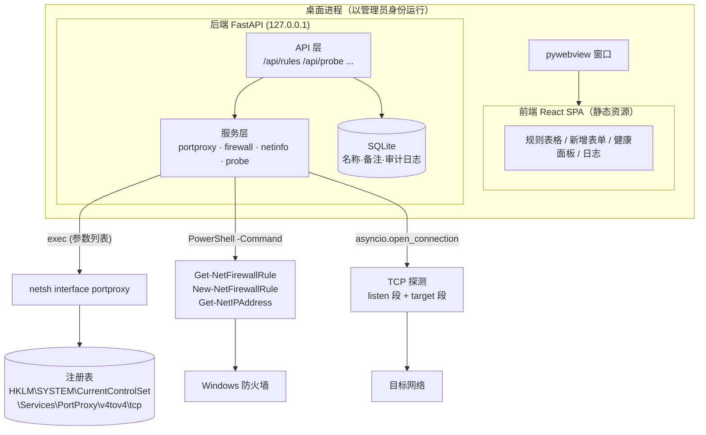

# Traffic Forwarding Manager

> Windows 端口转发（`netsh interface portproxy`）+ 防火墙规则（`New-NetFirewallRule`）的可视化管理工具
>
> React 前端 + FastAPI 本地后端 + pywebview 桌面套壳
>
> 📍 **分阶段执行计划、验收标准与时间估算见 [`ROADMAP.md`](./ROADMAP.md)**

---

## 1. 项目要解决的问题

日常需要在多网段之间做 TCP 流量转发，目前靠手敲命令：

```powershell
# 1. 开放入站端口
New-NetFirewallRule -DisplayName "ERP Forward" -Direction Inbound -Protocol TCP -LocalPort 8889 -Action Allow

# 2. 建立端口映射
netsh interface portproxy add v4tov4 listenport=8889 listenaddress=14.12.0.172 connectport=8889 connectaddress=192.168.1.199

# 3. 验证
Test-NetConnection -ComputerName 14.12.0.172 -Port 8889
```

痛点：

| 痛点 | 后果 |
| --- | --- |
| 命令长、参数多，`listenaddress` / `connectaddress` 极易写反 | 规则静默失效，不报错 |
| 规则存进注册表后**没有任何名称和备注** | 一周后回来看不懂 `17001 → 172.16.0.2` 是干什么的 |
| `netsh show all` 输出是本地化对齐文本 | 无法脚本化、无法做健康检查 |
| 规则和防火墙是两套独立命令 | 建了映射忘了开防火墙，排查方向跑偏 |
| `Test-NetConnection` 单条约 3~5 秒 | 5 条规则要等 20 秒 |

**目标**：一个本地桌面工具，可视化增删改查转发规则、自动联动防火墙、并发健康探测、带名称备注和审计日志。

---

## 2. 关键技术前提

> ⚠️ 这是整个方案唯一无法回避的硬约束，决定了架构形态。

**`netsh interface portproxy` 与 `New-NetFirewallRule` 都必须以管理员权限执行，浏览器网页无法直接调用系统命令。**

因此：

- ❌ 纯前端 SPA（即使打包成 Electron）无法完成核心功能
- ✅ 必须存在一个**以管理员身份运行的本地后端进程**，由它调用 `netsh` / `PowerShell`
- ✅ 前端只负责 UI，所有系统操作经 HTTP 走本地 `127.0.0.1` 后端

同时为了安全性，后端必须：

- 只监听 `127.0.0.1`（不是 `0.0.0.0`）
- 校验 `Origin` / 携带启动时生成的随机 token，防止本机其它程序或网页跨站调用
- 所有命令以**参数列表**方式调用，绝不拼接 shell 字符串

---

## 3. 技术选型

### 3.1 前端

| 组件 | 选型 | 理由 |
| --- | --- | --- |
| 框架 | **React 18 + TypeScript** | 生态成熟，类型安全 |
| 构建 | **Vite 5** | 启动快，产物可直接由 FastAPI 托管 |
| 样式 | **Tailwind CSS** | 快速搭出现代化界面，无需手写 CSS |
| 组件库 | **shadcn/ui** (+ Radix) | 无锁定、可裁剪、暗色主题开箱可用 |
| 表格 | **TanStack Table** | 规则列表需要排序 / 筛选 / 列配置 |
| 数据请求 | **TanStack Query** | 缓存、轮询刷新、乐观更新（健康状态定时刷新很关键） |
| 表单校验 | **React Hook Form + Zod** | IP / 端口 / 网段校验，与后端 Pydantic 规则对齐 |
| 图标 | **lucide-react** | 轻量 |

### 3.2 后端

| 组件 | 选型 | 理由 |
| --- | --- | --- |
| 框架 | **FastAPI** | 异步、Pydantic 校验、自动生成 OpenAPI 文档 |
| ASGI | **uvicorn** | 标准部署 |
| 数据模型 | **Pydantic v2** | 请求/响应校验，前端 Zod schema 与其一一对应 |
| 元数据存储 | **SQLite（标准库 `sqlite3`）** | 只存"名称/备注/标签/审计日志"；3 张小表不值得引入 ORM，少一层依赖更稳 |
| 系统调用 | **`asyncio.create_subprocess_exec`** | 异步不阻塞、参数列表形式防注入 |
| 打包 | **PyInstaller**（可选） | 后端可打为单文件 exe |

### 3.3 桌面套壳

**pywebview**（推荐）：后端进程内起一个窗口指向 `http://127.0.0.1:<port>`，体积小（约 10~20MB），依赖系统自带的 WebView2。

备选方案对比：

| 方案 | 体积 | 提权便利性 | 复杂度 |
| --- | --- | --- | --- |
| **pywebview**（推荐） | 小 | 直接给 Python 进程加 UAC manifest | 低 |
| Tauri | 小 | 需 Rust 侧面实现提权 | 中 |
| Electron | 大（100MB+） | Node 侧调命令，仍需提权 | 中高 |
| 纯浏览器 + 手动启动后端 | 最小 | 需手动右键"以管理员运行" | 最低（可作 M0 阶段） |

### 3.4 运行环境

已验证本机工具链：

```
uv     0.12.16
Python 3.11.16 (uv managed)
Node   v24.21.0
npm    11.19.0
OS     Windows (x64)
```

版本要求：Python ≥ 3.11，Node ≥ 20。

---

## 4. 总体架构



### 4.1 读写路径的关键设计

**读规则 → 读注册表，不解析 `netsh show`**

`netsh interface portproxy show all` 的输出是本地化、按列宽补齐的文本，中文环境下带全角空格，正则非常脆弱。直接读注册表：

```
HKLM:\SYSTEM\CurrentControlSet\Services\PortProxy\v4tov4\tcp\<listenaddress>/<listenport>
  connectaddress = 192.168.1.199
  connectport    = 8889
```

键名即 `listenaddress/listenport`，值即目标地址/端口 —— 完全结构化，可稳定解析。IPv6 场景对应 `v6tov4` / `v4tov6` / `v6tov6` 子键。

**写规则 → 走 `netsh`，不走注册表**

注册表直写虽可行，但 `netsh` 是微软支持路径（会做参数校验、格式规范化），且避免"写对了格式但系统不认"的隐患。

**规则本身没有名称** → 应用自己维护一份 SQLite 元数据表，用 `listen_ip:listen_port` 作为稳定主键关联展示名称、备注、标签。

---

## 5. 目录结构

```
traffic_forwarding/
├─ README.md
├─ backend/
│  ├─ pyproject.toml
│  ├─ app/
│  │  ├─ main.py                 # FastAPI 入口，挂载静态资源 + 路由
│  │  ├─ core/
│  │  │  ├─ config.py            # 端口、token、路径
│  │  │  ├─ security.py          # Origin / token 校验中间件
│  │  │  ├─ elevation.py         # IsUserAnAdmin 检测、UAC 自提权
│  │  │  └─ shell.py             # run_exec() 统一封装：超时/编码/错误归一
│  │  ├─ schemas/
│  │  │  ├─ rule.py              # PortProxyRule, RuleCreate, RuleUpdate
│  │  │  ├─ firewall.py          # FirewallStatus
│  │  │  ├─ net.py               # InterfaceInfo
│  │  │  └─ probe.py             # ProbeResult
│  │  ├─ services/
│  │  │  ├─ portproxy.py         # 注册表读 + netsh 增删
│  │  │  ├─ firewall.py          # PowerShell 规则的查/建/删
│  │  │  ├─ netinfo.py           # Get-NetIPAddress → 网卡列表
│  │  │  ├─ probe.py             # 双段 TCP 并发探测
│  │  │  └─ metadata.py          # SQLite 名称/备注/审计
│  │  ├─ api/
│  │  │  ├─ routes_rules.py
│  │  │  ├─ routes_interfaces.py
│  │  │  ├─ routes_firewall.py
│  │  │  ├─ routes_probe.py
│  │  │  ├─ routes_system.py
│  │  │  └─ routes_logs.py
│  │  └─ db/
│  │     ├─ models.py
│  │     └─ session.py
│  └─ tests/
│     ├─ test_portproxy_parse.py
│     ├─ test_shell_guard.py
│     └─ test_probe.py
├─ frontend/
│  ├─ package.json
│  ├─ vite.config.ts             # dev 模式下 /api 代理到 127.0.0.1:8000
│  ├─ tailwind.config.js
│  └─ src/
│     ├─ main.tsx
│     ├─ App.tsx
│     ├─ api/                    # client.ts + 各资源的 query/mutation
│     ├─ components/
│     │  ├─ RuleTable.tsx
│     │  ├─ RuleFormDialog.tsx
│     │  ├─ HealthBadge.tsx
│     │  ├─ InterfaceSelect.tsx
│     │  └─ AuditLogPanel.tsx
│     ├─ pages/
│     │  ├─ Dashboard.tsx
│     │  └─ Settings.tsx
│     ├─ hooks/
│     └─ types/                  # 由 OpenAPI 生成，与后端契约同源
├─ launcher/
│  ├─ main.py                    # uvicorn 线程 + pywebview 窗口（不能命名为 app.py）
│  ├─ traffic_forwarding.spec    # 正式打包（内嵌 requireAdministrator 清单）
│  ├─ traffic_forwarding.test.spec  # 免提权测试版，用于验证冻结环境
│  ├─ app.ico                    # exe 图标（由 scripts/make_icon.py 生成）
│  └─ app.manifest
├─ installer/
│  ├─ traffic_forwarding.iss     # Inno Setup 脚本（安装包）
│  └─ languages/                 # 简体中文安装向导语言文件
├─ scripts/
│  ├─ dev.ps1                    # 同时起 uvicorn --reload 与 vite dev
│  ├─ build.ps1                  # 构建前端 → 复制到 backend/static → PyInstaller
│  ├─ build-installer.ps1        # 生成 Setup.exe（调用 Inno Setup 的 ISCC）
│  ├─ make_icon.py               # PNG → 多尺寸 ICO / favicon
│  └─ run_as_admin.ps1           # Start-Process -Verb RunAs 包装
└─ .gitignore
```

---

## 6. 核心数据模型

```python
# schemas/rule.py
class PortProxyRule(BaseModel):
    id: str                       # f"{listen_address}:{listen_port}"，稳定主键
    name: str | None              # 来自 SQLite 元数据，系统本身没有
    note: str | None
    listen_address: IPvAnyAddress
    listen_port: int              # 1-65535
    connect_address: IPvAnyAddress
    connect_port: int
    proto: Literal["tcp"] = "tcp"  # portproxy 不支持 UDP
    firewall: FirewallStatus | None
    health: ProbeResult | None

class FirewallStatus(BaseModel):
    rule_name: str
    exists: bool
    enabled: bool
    action: Literal["Allow", "Block"] | None
    profiles: list[str]            # Domain / Private / Public
    stale: bool = False            # 规则存在但端口已无映射 → 孤儿规则

class ProbeResult(BaseModel):
    listen_ok: bool                # 本机 listen ip:port 是否在监听
    target_ok: bool                # 目标 connect ip:port 是否可达
    listen_latency_ms: float | None
    target_latency_ms: float | None
    checked_at: datetime
    error: str | None
```

**数据库（SQLite）只存三类东西**：

| 表 | 用途 |
| --- | --- |
| `rule_meta` | `rule_id` / `name` / `note` / `tags` / `created_at` / `created_by` |
| `audit_log` | 每次增删改的完整记录（含执行的命令原文、退出码、stdout/stderr） |
| `settings` | 探测超时、刷新间隔、默认防火墙 profile 等 |

这样即使有人用命令行手工改了规则，应用下次刷新时以系统状态为准，元数据多出来的条目会被标记为"孤儿"并可一键清理。

---

## 7. 后端关键实现要点

### 7.1 统一命令执行层

```python
# core/shell.py
async def run_exec(args: list[str], *, timeout: float = 15, encoding="gbk") -> CmdResult:
    """永不使用 shell=True / 字符串拼接；统一处理超时、编码、退出码。"""
```

- `netsh` 输出在中文 Windows 下是 GBK/CP936，需显式 `decode("gbk", errors="replace")`
- PowerShell 一律加 `-NoProfile -NonInteractive -OutputFormat Text`，输出结构统一转 JSON
- 每条命令写审计日志（原文 + 结果），失败时前端能直接看到原始报错

### 7.2 读取转发规则

```powershell
Get-ChildItem 'HKLM:\SYSTEM\CurrentControlSet\Services\PortProxy\v4tov4\tcp' |
  ForEach-Object {
    $n = $_.PSChildName -split '/'
    [pscustomobject]@{
      listen_address = $n[0]; listen_port = [int]$n[1]
      connect_address = (Get-ItemProperty $_.PSPath).connectaddress
      connect_port = [int](Get-ItemProperty $_.PSPath).connectport
    }
  } | ConvertTo-Json -Compress
```

> 用 `ConvertTo-Json` 而不是文本解析，彻底规避本地化问题。

### 7.3 写入/删除转发规则

```powershell
netsh interface portproxy add v4tov4 listenaddress=<IP> listenport=<PORT> connectaddress=<IP> connectport=<PORT>
netsh interface portproxy delete v4tov4 listenaddress=<IP> listenport=<PORT>
```

**必须做的前置校验**（`netsh` 自身几乎不校验）：

1. `listen_address` 必须存在于本机网卡（`Get-NetIPAddress`），否则规则创建成功但永不生效
2. `listen_address:listen_port` 不能与本机已监听端口冲突
3. `connect_address:connect_port` 可达性由健康探测给出**警告**而非阻止（目标可能暂时离线，属正常运维场景）
4. 端口范围 1~65535，禁用特权/系统保留端口时给出提示

**编辑 = 删除 + 新增**（portproxy 无 update 语义），需在同一事务内执行并记录，失败时尝试回滚。

### 7.4 防火墙联动

| 操作 | 命令 |
| --- | --- |
| 查询 | `Get-NetFirewallRule -Direction Inbound \| Get-NetFirewallPortFilter` 组合过滤 `LocalPort` |
| 创建 | `New-NetFirewallRule -DisplayName <名> -Direction Inbound -Protocol TCP -LocalPort <端口> -Action Allow -Profile Any` |
| 删除 | `Remove-NetFirewallRule -DisplayName <名>` |

设计原则：

- **DisplayName 由规则名称派生**（如 `ERP Forward`），新增规则时自动带出、可覆盖
- 端口已有对应 Allow 规则时**不重复创建**，列表里显示"已开放（复用 XXX）"
- 删除转发规则时提示是否同时删除防火墙规则（默认询问，不静默删除）
- 检测**孤儿规则**：防火墙开着端口但已无 portproxy 映射，列表中标黄

### 7.5 健康探测（双段）

`Test-NetConnection` 太慢且只测一段，改用纯异步 TCP 连接检测：

```python
async def tcp_probe(host: str, port: int, timeout: float = 1.5) -> float:
    t0 = time.perf_counter()
    _, writer = await asyncio.wait_for(asyncio.open_connection(host, port), timeout)
    writer.close()
    return (time.perf_counter() - t0) * 1000
```

- **listen 段**：连 `listen_address:listen_port`（源地址绑到同网卡以避免路由绕行）
- **target 段**：连 `connect_address:connect_port`
- 全部规则用 `asyncio.gather` 并发，5 条规则 < 2 秒
- 状态机：`healthy`（两段通）/ `half-open`（listen 通但目标不通）/ `down`（listen 不通）/ `unknown`

### 7.6 提权

```python
# core/elevation.py
def is_admin() -> bool:
    return ctypes.windll.shell32.IsUserAnAdmin() != 0
```

- 启动时若未提权 → 弹窗提示，并提供"以管理员身份重新启动"按钮（`ShellExecuteW(..., "runas", ...)`）
- 打包后的 exe 通过 `app.manifest` 声明 `requireAdministrator`，双击即弹 UAC
- **只读功能（查看规则、探测）在非管理员下依然可用**，写操作返回 `403` 并在 UI 上置灰

### 7.7 ARP 网段扫描

目标：不靠手工 `ping` 扫段，直接列出**每张网卡所在网段里已被占用的 IP**（含 MAC）。

两种引擎，`summary.engine` 会告诉前端当前用的是哪种：

| 引擎 | 原理 | 依赖 | 特点 |
| --- | --- | --- | --- |
| `npcap` | `ctypes` 加载 `wpcap.dll`，构造以太网 + ARP 请求（oper=1）发出，抓 oper=2 的应答 | 安装 Npcap | 能发现禁 Ping 设备，2.5 秒扫完 /24 |
| `fallback` | 向网段每个地址发一个 UDP 包触发系统 ARP 解析，再读 `Get-NetNeighbor` | 无 | 兜底可用，可能漏报，也可能带出近期缓存条目 |

实现要点：

```python
# services/arpscan.py
frame = b"\xff" * 6 + src_mac + b"\x08\x06"            # 以太网头
frame += struct.pack("!HHBBH", 1, 0x0800, 6, 4, 1)     # ARP 请求
frame += src_mac + src_ip + b"\x00" * 6 + dst_ip
```

- **网卡匹配**：`Get-NetAdapter.InterfaceGuid` ↔ Npcap 设备名 `\Device\NPF_{GUID}`，匹配不到再按 `InterfaceDescription` 模糊匹配
- **报文速率**：每 32 个包 `sleep 2ms`，避免驱动发送队列溢出；未应答目标每 ~0.8 秒重发一次，最多 3 轮
- **范围控制**：默认 `auto`（前缀小于 /24 时只扫所在 /24）；`full` 按真实前缀扫，超过 1024 个地址截断并在 `warning` 里说明
- **并发安全**：每次扫描独立 `pcap_open_live`，`扫描全部网卡` 可以并行执行
- **降级策略**：Npcap 缺失 / 打开网卡失败 / 无 MAC → 自动走回退引擎，前端卡上标记「邻居表回退」

---

## 8. API 契约

Base：`http://127.0.0.1:<port>/api`

| 方法 | 路径 | 说明 |
| --- | --- | --- |
| `GET` | `/system/status` | 是否管理员、OS 版本、后端版本、端口 |
| `GET` | `/system/interfaces` | 本机网卡 IPv4/IPv6 列表（供下拉选择） |
| `GET` | `/rules` | 全部规则（注册表 + 元数据 + 防火墙 + 最近健康状态合并） |
| `POST` | `/rules` | 新增（可 `open_firewall=true` 一并建防火墙规则） |
| `POST` | `/rules/validate` | 干跑校验：IP 是否本机、端口是否冲突、参数是否合法（不落盘）。**编辑时必须带 `exclude_id`**，否则会与自身冲突 |
| `PUT` | `/rules/{id}` | 编辑（内部 delete + add） |
| `DELETE` | `/rules/{id}?delete_firewall=false` | 删除 |
| `POST` | `/rules/{id}/probe` | 单条探测 |
| `POST` | `/probe/batch` | 全部（或指定 id 列表）并发探测 |
| `GET` | `/firewall/orphans` | 无对应映射的防火墙规则 |
| `GET` | `/logs?limit=100` | 审计日志 |
| `GET` | `/export` | 导出全部规则为 JSON（换机迁移） |
| `POST` | `/import` | 从 JSON 导入并重建规则 |
| `GET` | `/scan/engine` | 当前扫描引擎：`npcap` / `fallback`，含 Npcap 版本与路径 |
| `POST` | `/scan/arp` | 扫描指定网卡所在网段：入参 `{address, prefix_length, scope, timeout}`，返回汇总 + 在线主机（IP/MAC） |
| `WS` | `/ws/events` | 实时推送探测结果与命令执行进度 |

FastAPI 自动生成 `/docs`，前端类型由 OpenAPI 生成（`openapi-typescript`），保证前后端契约同源、不手写类型。

---

## 9. 前端设计

### 9.1 页面结构

```
┌─────────────────────────────────────────────────────────────┐
│  Traffic Forwarding        [管理员] [探测全部] [+ 新建规则]  │
├─────────────────────────────────────────────────────────────┤
│ 名称          监听                目标              防火墙  健康   │
│ ERP Forward   14.12.0.172:8889 → 192.168.1.199:8889  ✅   ●  12ms│
│ OA 14001      192.168.1.226:14001 → 14.12.0.105:8765 ✅   ●  8ms │
├─────────────────────────────────────────────────────────────┤
│ 审计日志（可折叠）                                            │
└─────────────────────────────────────────────────────────────┘
```

### 9.2 交互要点

- **顶部标签切换**：「转发规则」与「网段扫描」两个面板同时挂载、仅切换显隐，切换回来扫描结果不会丢
- **网卡 IP 下拉**：`listen address` 只能从 `GET /system/interfaces` 选择，从根上避免"IP 不存在导致静默失效"
- **实时预检**：表单填写时前端即调 `/rules/validate` 检查端口冲突、IP 是否本机，错误本地即时报出
- **健康状态自动轮询**：TanStack Query `refetchInterval` 默认 30s，可关闭
- **危险操作二次确认**：删除规则显示将要执行的命令原文，确认后才执行
- **命令回显**：每条增删改在 toast/抽屉里显示实际执行的 PowerShell 命令，保持"看得见的手工等价物"，方便你继续在命令行里操作
- **暗色主题 + 紧凑表格**：面向运维，不用花哨动效

---

## 10. 安全设计

| 风险 | 措施 |
| --- | --- |
| 命令注入 | 全部使用参数列表调用，禁止 `shell=True`；IP/端口先过 Pydantic 类型校验 |
| 本机其它程序调用 API | 后端仅绑 `127.0.0.1` + 启动时生成一次性 token，前端随请求头携带 |
| 恶意网页跨站请求 | 严格校验 `Origin` 为 `http://127.0.0.1:<port>`，拒绝 `null` 与外部域 |
| 提权滥用 | 提权后无远程监听、无外部网络入口；所有系统写操作留审计日志 |
| 误删生产规则 | 删除前展示命令原文 + 二次确认；审计日志记录完整可回滚信息 |
| 配置漂移 | 以系统真实状态为唯一事实源，元数据仅作补充 |

---

## 11. 打包、安装与下发

### 11.1 三步产物

```powershell
pwsh -File scripts\build.ps1 -Exe            # → dist\traffic-forwarding.exe（18.7 MB）
pwsh -File scripts\build-installer.ps1       # → dist\installer\TrafficForwarding-Setup-0.2.0.exe（20.5 MB）
```

`build-installer.ps1` 会先确保 exe 是最新的，再调用 Inno Setup 编译安装包（版本号自动取自 `backend/app/core/config.py` 的 `APP_VERSION`）。

需要的工具：

```powershell
winget install --id JRSoftware.InnoSetup -e     # 只需在构建机上装一次
```

### 11.2 安装包做了什么

| 项目 | 行为 |
| --- | --- |
| 安装目录 | `C:\Program Files\TrafficForwarding`（`{autopf}`，64 位） |
| 权限 | 安装过程弹 UAC（`PrivilegesRequired=admin`） |
| 快捷方式 | 开始菜单「转发管理器」+ 卸载项；桌面图标可选（默认不勾） |
| 卸载入口 | 控制面板 →「程序和功能」，或 `unins000.exe` |
| 升级 | AppId 固定，直接覆盖安装；**规则名称/备注/审计日志保留**（在 `%LOCALAPPDATA%\TrafficForwarding`） |
| 语言 | 简体中文（附带 `installer/languages/ChineseSimplified.isl`） |

### 11.3 静默安装 / 静默卸载

```powershell
# 安装（IT 下发常用）
.\TrafficForwarding-Setup-0.2.0.exe /VERYSILENT /SUPPRESSMSGBOXES /NORESTART `
    /LOG="C:\Temp\tf-install.log"

# 自定义目录
.\TrafficForwarding-Setup-0.2.0.exe /VERYSILENT /DIR="D:\Apps\TrafficForwarding"

# 卸载
"C:\Program Files\TrafficForwarding\unins000.exe" /VERYSILENT /SUPPRESSMSGBOXES
```

常用参数：`/VERYSILENT` 完全无界面、`/SUPPRESSMSGBOXES` 不弹框、`/NORESTART` 不重启、`/LOG=` 写安装日志、`/DIR=` 指定目录、`/TASKS="desktopicon"` 建桌面图标。

### 11.4 批量下发方式

| 场景 | 做法 |
| --- | --- |
| **SCCM / Intune** | 把 Setup.exe 作为 Application，安装命令用上面那行静默参数，检测规则用 `C:\Program Files\TrafficForwarding\traffic-forwarding.exe` 存在性 + 文件版本 |
| **域内 GPO** | 计算机配置 → 启动脚本，放一行 `Start-Process -FilePath "\\share\...\Setup.exe" -ArgumentList "/VERYSILENT /NORESTART" -Wait` |
| **一次性推几十台** | `PsExec -s -d -accepteula \\PC01 Setup.exe /VERYSILENT`（或用 WinRM `Invoke-Command`） |
| **登录脚本自检** | 检查 `HKLM\SOFTWARE\Microsoft\Windows\CurrentVersion\Uninstall\{9E2A1F0C-...}}_is1` 的 `DisplayVersion`，低于目标版本才装 |

> 安装包和 exe 都**没有代码签名**，首次运行会有 SmartScreen 提示。内网可接受的话直接放行；要消除提示需买代码签名证书，或用企业自签名证书 + 域内 GPO 分发信任链。

### 11.5 为什么用 Inno Setup 而不是 MSI

- 单个 exe，双击即装，最贴合"手动装一台"的场景
- 脚本化，改版本/目录/快捷方式就是改几行
- 需要 MSI（更严格的域策略、组策略软件安装）时，可用 WiX 重写；本项目未内置，若确实需要可另开一个 `installer/wix/` 用 `Product.wxs` 实现，`msiexec /i xxx.msi /qn` 即可静默安装

### 打包时踩过的四个坑

| 坑 | 现象 | 解决 |
| --- | --- | --- |
| **入口脚本与包同名** | 打包成功，但运行报 `ModuleNotFoundError: No module named 'app.main'` | 入口必须叫 `launcher/main.py`（不能叫 `app.py`，否则 PyInstaller 会把入口脚本和 `app` 包混为一谈） |
| **运行时 import 不被静态分析发现** | `pywebview` 在函数内 import，打包后回落成浏览器模式 | spec 的 `hiddenimports` 显式列出 `webview` / `webview.platforms.winforms` / `clr` / `clr_loader`，以及 `app.*` 全部子模块 |
| **windowed 模式下没有标准流** | `console=False` 时 `sys.stdout` 为 `None`，uvicorn 日志格式化器调用 `.isatty()` 直接崩：`AttributeError: 'NoneType' object has no attribute 'isatty'` | 启动器在导入 uvicorn 之前把 `stdout/stderr/stdin` 重定向到 `%LOCALAPPDATA%\TrafficForwarding\launcher.log` |
| **自定义 manifest 被忽略** | 明明传了 `manifest=app.manifest`，但 exe 里嵌的仍是 `asInvoker`，双击根本不弹 UAC，程序以普通权限跑起来 | PyInstaller 6 必须再加 `uac_admin=True`；否则 `create_application_manifest()` 会把执行级别合并成 `asInvoker`。验证方法：扫描 exe 字节里是否含 `requireAdministrator` |

### 权限要求

程序启动即要求管理员权限，两道检查：

1. **清单层**：exe 内嵌 `requireAdministrator`，双击弹 UAC；用户点「否」则进程根本不会启动。
2. **启动器层（兜底）**：若清单被绕过（开发模式直接 `python launcher/main.py`、计划任务、去掉清单的构建），启动器会检测 `IsUserAnAdmin()`，非管理员则弹出：

   > 本程序需要管理员权限才能管理端口转发与防火墙规则。
   > 请点击『是』以管理员身份重新启动，或点击『否』退出程序。

   选「是」直接以管理员身份重启；选「否」（或提权失败）立即退出，不会留下后台进程。

后端仍有读-only 降级能力（可直接 `uvicorn app.main:app` 起来看数据），但**打包版不会以非管理员身份运行**。

### 更换图标

```powershell
uv run --with pillow python scripts\make_icon.py <源图片.png>
pwsh -File scripts\build.ps1 -Exe
```

脚本会生成多尺寸 ICO（16/24/32/48/64/128/256）：

| 产物 | 用途 |
| --- | --- |
| `launcher/app.ico` | 打包进 exe（`traffic_forwarding.spec` 的 `icon=`） |
| `frontend/public/favicon.ico` | 浏览器标签页 |
| `frontend/public/favicon.png` | 高分辨率备用（64px） |

> 非正方形图片会自动居中裁切；透明背景会保留，纯色背景则原样保留。

### 崩溃排查

windowed 模式没有控制台，所有输出（含未捕获异常的 traceback）都会写入：

```
%LOCALAPPDATA%\TrafficForwarding\launcher.log
```

### 单实例与退出行为

- 启动时用命名互斥体 `Local\TrafficForwarding.SingleInstance` 加锁，**重复双击只会提示「已在运行」，不会再开第二个窗口**。
- 关闭窗口后走 `os._exit(0)` 强制退出，避免 pythonnet/WinForms 或 onefile 的父进程残留（残留会导致下次启动看起来"又冒出一个窗口"）。
- 窗口生命周期会写进 `launcher.log`：`创建窗口` / `窗口已关闭` / `webview.start() 返回`。
- 如果确实残留了：`Get-Process traffic-forwarding* | Stop-Process -Force`

### 冻结后的路径行为（已实测）

- 数据库：`%LOCALAPPDATA%\TrafficForwarding\app.db`（不写在 exe 旁边，避免 Program Files 只读）
- 静态资源：`_MEIxxxx\backend\app\static`
- 端口：未指定 `TFM_PORT` 时自动挑一个空闲端口，仅监听 `127.0.0.1`

### 验证用开关（无需点 UAC 也能测）

| 环境变量 | 作用 |
| --- | --- |
| `TFM_PORT=8123` | 固定端口 |
| `TFM_NO_GUI=1` | 只跑后端，不开窗口（配合浏览器或 curl 验证） |
| `TFM_SELFTEST=1` | 只检查 pywebview / pythonnet 是否能加载，立即退出 |
| `TFM_ALLOW_NO_ADMIN=1` | 跳过启动器的管理员检查（仅自动化测试用） |

---

## 12. 里程碑

| 阶段 | 内容 | 产出 |
| --- | --- | --- |
| **M0** | 后端骨架 + 只读规则列表 + 健康探测 | 能在网页看到现有 5 条规则与实时连通性 |
| **M1** | 新增 / 编辑 / 删除规则 + 元数据名称备注 | 核心功能可用，可替代手敲命令 |
| **M2** | 防火墙联动 + 孤儿规则检测 | 建映射自动开端口，漏配可发现 |
| **M3** | 审计日志 + 导入导出 + 定时自动探测 | 可追溯、可迁移 |
| **M4** | pywebview 套壳 + manifest 提权 + PyInstaller 打包 | 双击即用的桌面应用 |
| **M5**（可选） | UDP 转发替代方案、多机远程管理、Prometheus 指标 | 扩展能力 |

> 建议 M0~M1 阶段先用「浏览器 + `run_as_admin.ps1` 手动启动后端」验证价值，确认好用后再投入 M4 打包。

---

## 13. 已知限制（务必提前知晓）

| 限制 | 说明 | 应对 |
| --- | --- | --- |
| **portproxy 不支持 UDP** | 系统能力所限 | UI 上只提供 TCP；UDP 需求另议（需第三方工具） |
| **`netsh` 几乎不校验参数** | 目标地址不可达、`listenaddress` 非本机 IP 都返回成功 | 应用层强校验 + 健康探测兜底 |
| **规则无名称属性** | 名称存在应用自己的 SQLite | 命令行手工改动的规则在 UI 中显示为"未命名" |
| **同一 `listen ip:port` 只能一条** | 重复 add 会覆盖 | 表单预检 + 后端冲突检测 |
| **无"启用/禁用"概念** | 有映射即生效 | 用"删除/新增"或导出后删除来模拟；UI 不提供假开关 |
| **UAC 每次都要点确认** | Windows 提权机制 | 可选：注册计划任务（最高权限、按需触发）实现免弹窗启动 |
| **中文输出编码** | `netsh` 输出为 GBK | 统一 `decode("gbk", errors="replace")`；关键路径改用 `ConvertTo-Json` |
| **端口被占用/冲突** | 第三方程序可能已监听同端口 | 探测前用 `Get-NetTCPConnection -LocalPort` 检查并提示 |

---

## 14. 开发环境

```powershell
# 一次性准备
$env:PATH = "D:\CodePrograms\uv;D:\CodePrograms\volta;" + $env:PATH

cd d:\Code\traffic_forwarding\backend
uv sync                                  # 创建 .venv 并装依赖

cd ..\frontend
npm install

# 开发（两个终端，或直接用 scripts\dev.ps1）
uv run uvicorn app.main:app --reload --host 127.0.0.1 --port 8000
npm run dev                              # http://127.0.0.1:5173，/api 代理到 8000

# 以管理员身份启动后端（需要写操作时）
pwsh -File scripts\run_as_admin.ps1
```

> ⚠️ 项目路径必须保持纯 ASCII（当前 `d:\Code\traffic_forwarding` 已满足）。uv 的 editable 安装生成的 `.pth` 内容为项目路径，若含中文会导致 Python 启动 `init_import_site` 崩溃。

---

## 15. 参考：等价的命令行操作

应用每次操作都会在 UI 中回显它实际执行的命令，方便与手工操作对照。

新增 `14.12.0.172:8889 → 192.168.1.199:8889` 并开放防火墙：

```powershell
New-NetFirewallRule -DisplayName "ERP Forward" -Direction Inbound -Protocol TCP -LocalPort 8889 -Action Allow
netsh interface portproxy add v4tov4 listenport=8889 listenaddress=14.12.0.172 connectport=8889 connectaddress=192.168.1.199
```

删除：

```powershell
netsh interface portproxy delete v4tov4 listenaddress=14.12.0.172 listenport=8889
Remove-NetFirewallRule -DisplayName "ERP Forward"
```

---

## 16. 备选方案：Rust 全包（Tauri）

**结论：完全可以，而且比 Python 方案更"全包"。**

Python 方案的本质是"Python 进程 + WebView + 大量 shell 出站调用"；Rust 方案可以做到：

- 不依赖 Python 运行时（产物 3~10MB 单 exe，冷启动 <300ms）
- 绝大多数系统操作**直调 Win32/COM API**，不再 spawn PowerShell 解析文本
- 前端仍复用 React，只是传输层从 HTTP 换成 Tauri IPC（**根本不开放本地端口**，token/Origin 那套防护直接不需要）
- 唯一保留的 shell 出站只剩 `netsh`（写 portproxy 没有公开 API，见下）

### 16.1 三条"全包"路线的区别

| 路线 | 含义 | 前端 | 系统操作 | 评价 |
| --- | --- | --- | --- | --- |
| **A. Tauri + React**（推荐） | Rust 做后端与桌面壳，前端仍是 React | React（复用现有生态） | Win32/COM + `netsh` | 收益最大、成本可控 |
| **B. 纯 Rust 前端** | Leptos / Dioxus / egui 全 Rust | 无 WebView 或 WASM | 同上 | 收益极小，表格/表单/弹窗生态远不如 React |
| **C. 用户态代理** | Rust 自己实现 TCP/UDP 转发循环，不用 portproxy | 任意 | 自己写代理 + 防火墙 API | **唯一能突破 netsh 能力边界**的方案，见 16.4 |

### 16.2 Python → Rust 实现映射

| 能力 | Python 方案 | Rust 方案 |
| --- | --- | --- |
| 读转发规则 | PowerShell 读注册表 + 解析 JSON | `winreg` crate **进程内直读**，零子进程开销 |
| 写转发规则 | `netsh` 子进程 | `tokio::process::Command::new("netsh").args([...])`（同左，参数列表形式） |
| 防火墙查询/新增 | `Get-NetFirewallRule` / `New-NetFirewallRule` | `windows` crate 调 COM `INetFwPolicy2`，单次约 5ms（PowerShell 约 300~600ms） |
| 网卡枚举 | `Get-NetIPAddress` | `windows` crate `GetAdaptersAddresses` |
| 健康探测 | `asyncio.open_connection` | `tokio::net::TcpStream` + `timeout`，语义等价 |
| 中文输出解码 | `decode("gbk")` | `encoding_rs::GBK.decode()` |
| 前后端类型契约 | `openapi-typescript` | `tauri-specta` 自动生成 TS 类型 |
| 提权 | `app.manifest` | `embed-resource` 嵌入 `.manifest`（`requireAdministrator`） |

### 16.3 两个必须知道的实现细节

**① 写 portproxy 仍建议走 `netsh`，不要直写注册表**

注册表 `...\Services\PortProxy\v4tov4\tcp` 只是 iphlpapi 的存储位置，直接写键值后规则通常**不会立即生效**（需重启 IP Helper 服务或重启系统），而 `netsh` 会触发正确的通知流程。所以：**读直读注册表、写仍调 netsh** —— 这条原则与 Python 方案完全一致。

**② 提权建议拆成"免提权 UI + 提权 sidecar"**

| 方式 | 体验 | 复杂度 |
| --- | --- | --- |
| 主 exe 嵌 `requireAdministrator` | 每次启动弹 UAC | ★ |
| UI 不提权 + sidecar（Windows 服务 / 计划任务 / 按需 `runas` 子进程），两者用 **named pipe** 通信 | 弹一次后长期免打扰，且符合最小权限 | ★★★（推荐） |

sidecar 方案还顺带解决"关掉 UI 转发生效、开着 UI 也没关系"的语义问题——转发规则本来就该独立于界面进程存活。

### 16.4 路线 C：自己写代理（Rust 的真正杀手锏）

README 第 13 节列的限制里，有三条是 `portproxy` 本身的能力边界，换成用户态代理即可全部消除：

| 现有限制 | 用户态代理能否解决 | 说明 |
| --- | --- | --- |
| 不支持 UDP | ✅ | 直接写 UDP relay 循环 |
| 无启用/禁用 | ✅ | 绑定/解绑 socket 即可，真正的开关 |
| 无法统计流量 | ✅ | 每条规则记录连接数、字节数、错误率 |
| 目标不可达时静默成功 | ✅ | 连接失败直接反映在面板上 |
| 依赖系统组件 | ✅ | 规则存 SQLite，UI 即事实源 |

代价：需要一个常驻进程（服务化）、要处理半关闭/超时/背压、绑特权端口需提权、高频小包场景性能需要实测。

**判断标准**：如果只转发 ERP/OA 这类低频业务流量 → 路线 A 足够；如果将来要 UDP、要开关、要流量统计 → 路线 C 是唯一正解，而它只有 Rust（或 Go）好写。

### 16.5 成本对照

| | Python(FastAPI) | Rust(Tauri 路线 A) | Rust(路线 C) |
| --- | --- | --- | --- |
| 到可用 MVP | 2~3 天 | 5~7 天 | 7~10 天 |
| 产物体积 | 20~40MB（含运行时） | 3~10MB | 3~10MB |
| 冷启动 | 1~2s | <300ms | <300ms |
| 主要成本 | 打包与编码坑 | COM 互操作、manifest 提权 | 代理正确性与性能调优 |
| 长期可维护性 | 一般（大量字符串/文本交互） | 好（编译期保证） | 好 |

### 16.6 推荐路线

1. **先用 Python 版跑通 M0~M1**（2~3 天），把 UI 形态、字段、校验规则这些"产品决策"确定下来；
2. 若确认长期使用，**再按路线 A 用 Rust 重写后端**——此时前端 React 代码与 API 契约几乎可以原样迁移，等于只重写 500 行左右的系统调用层；
3. 若中途发现需要 UDP / 开关 / 流量统计，则直接切到**路线 C**，把转发内核换成 Rust 用户态代理。

> 不建议一上来就用 Rust 从零开始：这个项目的难点不在语言，而在"搞清楚 Windows 上哪些操作有 API、哪些只能靠 netsh"，这部分知识用 Python 试错比用 Rust 试错快得多。

---

## 17. 实现状态与实测发现

> 本节记录 **代码已经落地并在这台机器上验证过的** 内容，以及三处与上面设计文档不同的地方。
> 分阶段计划见 [`ROADMAP.md`](./ROADMAP.md)。

### 17.1 已实现

| 层 | 内容 |
| --- | --- |
| 后端 `backend/app` | 注册表读取（双格式）、netsh 增删、netinfo、双段并发探测、防火墙查询/创建/删除、SQLite 元数据与审计、ARP 网段扫描（Npcap + 回退）、18 个接口 |
| 前端 `frontend/src` | 规则表格 + 健康徽章 + 防火墙徽章 + 新建/编辑弹窗（实时预检 + 命令预览）+ 删除确认 + 审计日志面板 + 统计卡 + 网段扫描页（按网卡分组、Npcap/回归引擎标记） |
| 脚本 `scripts` | `dev.ps1`（双服务）、`run_as_admin.ps1`（提权启动）、`build.ps1`（构建 + 复制 + 可选打包）、`build-installer.ps1`（生成 Setup.exe）、`make_icon.py`（图标转换） |
| 启动器 `launcher` | uvicorn 线程 + pywebview 窗口 + `requireAdministrator` manifest + PyInstaller spec |

### 17.2 三处与设计文档不同（都是实机验证后的修正）

**① portproxy 注册表有两种存储形式，本机用的是「值」形式**

设计文档里写的是"子键名 = `IP/端口`，子键内 `connectaddress`/`connectport`"。实测本机是：

```
HKLM\SYSTEM\CurrentControlSet\Services\PortProxy\v4tov4\tcp
    值名   "14.12.0.172/8889"
    值数据 "192.168.1.199/8889"
```

如果只按子键形式读，会得到 0 条规则。`portproxy.read_rules()` 现在**两种形式都读**并按 `IP:端口` 去重。

**② 防火墙读取同样需要管理员**

原本以为只有写入需要提权。实测 `Get-NetFirewallRule` 在非管理员下直接抛「拒绝访问」，因此：

- `/api/firewall/*` 在无权限时返回 `available:false` + 原因，UI 显示「需管理员」而非报错
- 同时发现本机三个防火墙 profile（Domain/Private/Public）**当前都是关闭状态**

**③ 元数据存储改用标准库 `sqlite3`**

3 张小表不需要 ORM，去掉 SQLAlchemy 少约 5MB 依赖与一层心智负担。

### 17.3 实测结果

| 验证项 | 结果 |
| --- | --- |
| 读取规则 | 5 条，与 `netsh interface portproxy show all` 完全一致 |
| 双段探测（5 条） | 约 3.0 秒（含两条 1.5s 超时的失效规则） |
| 探测准确性 | 8889 / 14001 判定 `healthy`；17001×2、17002 判定 `down`，与 `Get-NetTCPConnection -State Listen` 结果一致 |
| 预检：非法监听 IP | 正确报错「不属于本机任何网卡」 |
| 预检：重复监听端 | 正确报错「已存在相同监听端」+ 端口占用警告 |
| 非管理员降级 | 可看可测，写按钮置灰，防火墙列显示「需管理员」 |
| 前端构建 | `tsc --noEmit` + `vite build` 通过，产物 205KB（gzip 65KB） |

> 顺带发现：现有 5 条规则中，`17001`（两条）与 `17002` 是**失效规则**——注册表里有记录，但端口根本没有监听。

### 17.4 尚未验证的部分

| 项目 | 原因 |
| --- | --- |
| 真实创建 / 删除规则 | 需要管理员权限，本会话拿不到 UAC；逻辑已按「netsh 执行 → 审计 → 失败回滚」实现 |
| 防火墙创建 / 孤儿检测 | 同上，且本机防火墙已关闭 |
| 双击 exe 走 UAC 提权流程 | exe 已构建并验证（后端可启动、`/api/rules` 读到 5 条、pywebview 可加载），但**提权弹窗需要你手动点确认** |

### 17.5 运行方式

```powershell
# 只读查看（无需管理员）
cd d:\Code\traffic_forwarding\backend
uv run uvicorn app.main:app --port 8000
# 打开 http://127.0.0.1:8000

# 需要增删改：以管理员身份启动（会弹 UAC）
pwsh -File scripts\run_as_admin.ps1
```

### 17.6 主题（跟随系统 / 亮色 / 暗色）

- **实现方式**：`index.css` 里只定义语义化颜色 token（`--color-panel`、`--color-ink`、`--color-ok-ink` …），`.dark` 覆盖同名变量；组件全部使用 `bg-panel` / `text-ink-3` / `border-line` 这类类名。
  **没有任何 `dark:` 变体，也没有手写样式规则**（原有 `body`、滚动条、keyframes 等 CSS 已全部换成 Tailwind 类）。
- **持久化**：模式存 `localStorage.tfm-theme`；`<head>` 内联脚本在首帧前应用，避免暗色启动闪白。
- **跟随系统**：监听 `prefers-color-scheme` 变化实时切换；同时同步 `color-scheme`，让原生滚动条、下拉框、复选框跟随主题。
- **入口**：标题栏右侧三段式开关（监视器 / 太阳 / 月亮图标）。
