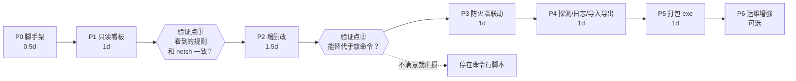

# 实施路线图（Roadmap）

> 从零到可交付的完整执行计划。
> 技术方案见 [`README.md`](./README.md)，本文只回答：**先做什么、后做什么、每步怎么算完成**。

---

## 执行状态（2026-10-22）

| 阶段 | 状态 | 说明 |
| --- | --- | --- |
| P0 脚手架 | ✅ 完成 | uv + Vite + Tailwind v4 + 代理，前后端联通 |
| P1 只读看板 | ✅ 完成 | 规则列表 / 网卡枚举 / 双段并发探测，实机验证通过 |
| P2 增删改 | 🟢 代码完成（写操作待管理员实测） | CRUD + 四道校验 + 元数据 + 审计日志 |
| P3 防火墙联动 | 🟡 代码完成，未实测 | 本机非管理员 + 防火墙 profile 全关，无法验证 |
| P4 日志/导入导出 | ✅ 完成 | 审计面板、`/export`、`/import`、定时探测 |
| P5 打包 | � 已打包并验证冻结运行 | `dist/traffic-forwarding.exe` 18.7MB；免提权测试版验证了后端启动、注册表读取、pywebview 加载；仅双击 UAC 流程需人工确认 |
| P6 运维增强 | 🟡 进行中 | ✅ ARP 网段扫描（Npcap 引擎 + 邻居表回退，独立「网段扫描」标签）；其余按需 |

**三处实机修正（已写入代码，详见 README 17.2）**

1. portproxy 注册表在本机是「值」形式（值名 `IP/端口` = 值数据 `目标IP/目标端口`），不是设计时假设的「子键」形式 → 现在两种都读
2. `Get-NetFirewallRule` 在本机非管理员直接「拒绝访问」 → 防火墙状态降级为「需管理员」而非报错
3. 元数据存储改用标准库 `sqlite3`（去掉 SQLAlchemy）

**顺带发现**：现有 5 条规则里 `17001`（两条）和 `17002` 已经失效——注册表有记录但端口没在监听。

---

## 0. 总览

原则：**每个阶段结束都必须是一个"能跑起来、能演示"的状态**，不做半成品堆积。

| 阶段 | 目标 | 交付物 | 预计 | 结束后你能做什么 |
| --- | --- | --- | --- | --- |
| **P0** | 项目脚手架 | 前后端各能启动 | 0.5 天 | 打开页面看到"Hello" |
| **P1** | 只读看板 | 规则列表 + 健康探测 | 1 天 | **在网页上看清现有 5 条规则是否通** |
| **P2** | 增删改 | 规则 CRUD + 名称备注 | 1.5 天 | **彻底不用再手敲 netsh** |
| **P3** | 防火墙联动 | 建映射自动开端口 | 1 天 | 不再出现"端口通了但业务不通" |
| **P4** | 探测/日志/导入导出 | 定时探测 + 审计 | 1 天 | 可追溯、可换机迁移 |
| **P5** | 打包成 exe | 双击即用的桌面应用 | 1 天 | 脱离终端，像正常软件一样用 |
| **P6** | 运维增强（可选） | 免 UAC / 自启 / 代理内核 | 按需 | 长期无人值守 |

合计约 **6 个工作日**到 P5，其中 P1 结束（第 2 天）就已经有实用价值。



> 两个验证点是"止损点"：如果 P1 或 P2 之后你觉得还不如手敲命令快，就此打住，只损失 1~2 天。

---

## P0 · 项目脚手架（0.5 天）

**目标**：打通"前端能调后端"的最小链路，避免后面把时间浪费在环境问题上。

### 任务

- [ ] 建立目录骨架：`backend/app/{core,schemas,services,api,db}`、`frontend/`、`launcher/`、`scripts/`、`data/`
- [ ] 后端依赖（`uv add`）：`fastapi`、`uvicorn[standard]`、`pydantic-settings`、`sqlalchemy`、`aiosqlite`
- [ ] 前端脚手架：`npm create vite@latest frontend -- --template react-ts`，接入 Tailwind + shadcn/ui
- [ ] Vite `server.proxy` 把 `/api` 代理到 `127.0.0.1:8000`
- [ ] `.gitignore`：`.venv/`、`node_modules/`、`dist/`、`data/*.db`、`__pycache__/`
- [ ] `scripts/dev.ps1`（同时起 uvicorn + vite）、`scripts/run_as_admin.ps1`（`Start-Process -Verb RunAs`）

### 验收（Definition of Done）

- [ ] `uv run uvicorn app.main:app --reload` → 浏览器打开 `/docs` 能看到 OpenAPI 页面
- [ ] `npm run dev` → `http://127.0.0.1:5173` 页面能显示后端 `/api/health` 返回的版本号
- [ ] 关掉后端，前端能显示"后端未连接"而不是白屏

### 风险

| 风险 | 应对 |
| --- | --- |
| `uv` 不在终端 PATH | `$env:PATH = "D:\CodePrograms\uv;" + $env:PATH`，或重启 VS Code |
| 项目路径含中文导致 `init_import_site` 崩溃 | 当前 `d:\Code\traffic_forwarding` 已是纯 ASCII，勿随意迁移 |

---

## P1 · 只读看板 + 健康探测（1 天）⭐ 最高价值阶段

**目标**：不写任何规则，先把现有状态**看得见**。这一步做完就已经解决了你 80% 的痛点（"看不懂 17001 是干什么的"除外，那要等 P2）。

### 任务

- [ ] `core/shell.py`：`run_exec(args, timeout, encoding="gbk")` —— 参数列表、超时、编码统一处理
- [ ] `services/portproxy.py::list_rules()`：Python 标准库 `winreg` 直读 `HKLM\SYSTEM\CurrentControlSet\Services\PortProxy\v4tov4\tcp`
      （比 spawn PowerShell 快 20 倍，且无本地化解析问题）
- [ ] `services/netinfo.py::list_interfaces()`：`Get-NetIPAddress -AddressFamily IPv4 | ConvertTo-Json`
- [ ] `services/probe.py`：`asyncio.open_connection` + `wait_for(1.5s)`，listen 段与 target 段分开测
- [ ] `api/routes_rules.py`：`GET /api/rules`（仅系统数据，不含元数据）
- [ ] `api/routes_system.py`：`GET /system/status`（`IsUserAnAdmin` 判定）、`GET /system/interfaces`
- [ ] `api/routes_probe.py`：`POST /probe/batch`（全部并发）
- [ ] 前端：`RuleTable` + `HealthBadge`（healthy / half-open / down / unknown）+ 刷新按钮
- [ ] 非管理员状态：顶部黄色横幅 + 写操作入口置灰

### 验收

- [ ] 页面列出的规则与 `netsh interface portproxy show all` **完全一致**（含当前这 5 条）
- [ ] 点击"探测全部"→ **2 秒内**所有规则出结果（对比：`Test-NetConnection` 要 20 秒）
- [ ] 故意把某条规则的目标地址改成不存在的 IP → 显示 `half-open` 而非全绿
- [ ] 非管理员启动 → 能看、能测，不能改

### 阶段产出演示

```
名称     监听                   目标                    健康
未命名   192.168.1.226:17001 → 172.16.0.2:17001        ● 3ms
未命名   14.12.0.172:17001   → 172.16.0.2:17001        ● 5ms
未命名   14.12.0.172:8889    → 192.168.1.199:8889      ● 12ms
未命名   192.168.1.226:14001 → 14.12.0.105:8765        ● 8ms
```

---

## P2 · 增删改 + 名称备注（1.5 天）⭐ 核心功能

**目标**：能真正替代那三条 PowerShell 命令。

### 任务

- [ ] SQLite：`rule_meta(rule_id PK, name, note, tags, created_at)`、`audit_log(...)`
- [ ] `services/metadata.py`：名称读写、孤儿元数据检测
- [ ] `POST /rules/validate`：干跑校验（不落盘）
- [ ] 四道前置校验：
      1. `listen_address` 属于本机网卡
      2. `listen ip:port` 未与已有规则或已监听端口冲突
      3. 端口范围 1~65535，`connect_address != listen_address`
      4. 目标可达性仅作 warning
- [ ] `POST /rules` / `PUT /rules/{id}`（delete+add）/ `DELETE /rules/{id}`
- [ ] 写操作事务化：失败则尝试回滚并记录
- [ ] 前端 `RuleFormDialog`：网卡 IP 下拉、名称、备注、端口、**实时显示的等价命令预览**
- [ ] 删除二次确认：展示将要执行的命令原文
- [ ] 每条操作后回显实际执行的命令（toast / 抽屉）

### 验收

- [ ] 新建 `14.12.0.172:8889 → 192.168.1.199:8889`，`regedit` 中可见、**立即生效**（无需重启）
- [ ] 手输一个不属于本机的 `listen_address` → 前端直接拦住，不发出请求
- [ ] 端口填越界值 / 填非数字 → 前后端双拦截
- [ ] 给现有 5 条规则补上名称和备注，**重启应用后名称仍在**
- [ ] 删除后 `netsh show all` 中确实消失，审计日志留有记录

### 风险

| 风险 | 应对 |
| --- | --- |
| 误删在用规则 | 删除前展示命令原文 + 二次确认；先导出 JSON 备份 |
| 编辑 = 删了重加，中途失败导致规则丢失 | 先校验、再删、失败即按原参数重建；日志留全量参数 |

---

## P3 · 防火墙联动（1 天）

**目标**：建映射时顺手开端口，并发现历史遗留的不一致。

### 任务

- [ ] `services/firewall.py::list_tcp_allow()`：`Get-NetFirewallRule -Direction Inbound` + `Get-NetFirewallPortFilter` + `ConvertTo-Json`
- [ ] `create_rule(name, port)` / `remove_rule(name)`
- [ ] **复用检测**：端口已被 Allow 规则覆盖 → 不重复创建，UI 显示"已开放（复用 XXX）"
- [ ] **孤儿检测**：防火墙开着端口但无 portproxy 映射 → 标黄，可一键清理
- [ ] `GET /firewall/orphans`
- [ ] 新增规则表单增加 `open_firewall` 开关（默认开），`DisplayName` 由规则名派生、可改
- [ ] 删除转发规则时**询问**是否同删防火墙规则（不静默）

### 验收

- [ ] 新建转发时勾选开防火墙 → 一条命令完成两件事，`Get-NetFirewallRule` 能查到
- [ ] 手工 `netsh delete` 掉一条规则但保留防火墙规则 → 刷新后以"孤儿"标黄出现
- [ ] 同名防火墙规则已存在时不报错，正确显示复用

---

## P4 · 定时探测 / 审计日志 / 导入导出（1 天）

### 任务

- [ ] 前端 TanStack Query `refetchInterval` 默认 30s，可在设置里关闭
- [ ] 后端可选：`asyncio` 后台任务缓存探测结果，供多标签页共享
- [ ] `audit_log` 完整记录：时间、操作类型、规则参数、执行的命令原文、退出码、stdout/stderr 摘要
- [ ] `GET /logs?limit=100` + 前端日志面板（可折叠）
- [ ] `GET /export` / `POST /import`：JSON 含规则 + 元数据 + 防火墙意图
- [ ] 设置页：探测超时、刷新间隔、默认防火墙 profile

### 验收

- [ ] 全量探测 5 条规则 < 2 秒
- [ ] 从审计日志能完整还原"某天某人执行了什么命令、结果如何"
- [ ] 导出 JSON → 删掉一条规则 → 导入 → 规则和名称都回来

---

## P5 · 打包成桌面应用（1 天）

### 任务

- [ ] `npm run build` → `frontend/dist` 复制到 `backend/app/static`
- [ ] `launcher/app.py`：后台线程跑 uvicorn（随机空闲端口）→ pywebview 指向 `127.0.0.1:<port>`
- [ ] `launcher/app.manifest`：`requestedExecutionLevel level="requireAdministrator"`
- [ ] PyInstaller spec（`--add-data` 静态资源、`--manifest`、`--icon`）
- [ ] `scripts/build.ps1` 一键：清 dist → 装依赖 → build 前端 → 复制 → pyinstaller
- [ ] 首次运行处理：DB 路径（`%LOCALAPPDATA%\TrafficForwarding\app.db`）、日志目录、端口占用重试
- [ ] 单机 smoke test 清单

### 验收（Smoke Test 清单）

- [ ] 双击 exe → 弹 UAC → 窗口打开 → 5 条规则正确显示
- [ ] 新增 → 删除 → 全程无终端黑窗
- [ ] 关掉程序再打开，名称备注仍在
- [ ] 断网 / 目标机离线时界面不卡死、不白屏
- [ ] 在另一台同网段机器上测试：解压即用（或至少能正常启动）

---

## P6 · 运维增强（可选，按需）

按优先级从高到低，**什么时候真需要了再做**：

- [ ] **免 UAC 启动**：注册计划任务（最高权限）→ UI 走 `schtasks /run`；或拆提权 sidecar + named pipe
- [ ] **开机自启**：计划任务触发器
- [ ] **一键体检**：检查所有规则的两段连通性 + 防火墙状态 + 端口占用，输出报告
- [ ] **多机管理**：在每台机器装 agent，中心端汇总（需要鉴权，复杂度陡增）
- [ ] **路线 C：Rust 用户态代理**（见 README 16.4）—— 需要 UDP / 真开关 / 流量统计时才做

---

## 阶段质量门（每阶段都要过）

| 检查项 | 说明 |
| --- | --- |
| 无管理员权限时功能降级而非崩溃 | 只读可用，写操作返回 403 + 友好提示 |
| 所有系统命令可在日志中还原 | 参数、退出码、错误输出三件套 |
| 出错信息面向人话 | "listen 地址 1.2.3.4 不属于本机网卡" 而不是抛 traceback |
| 前端不出现原始英文异常 | 统一 error boundary + toast |
| 改动前后跑一次 `GET /rules` 与 `netsh show all` 对齐 | 防止状态漂移 |

---

## 风险与卡点总表

| 卡点 | 出现阶段 | 应对 |
| --- | --- | --- |
| 提权每次弹 UAC | P5 | 先接受；真烦了做 P6 计划任务方案 |
| `netsh` 输出 GBK 乱码 | P1/P3 | 只在必须解析时用；优先 `ConvertTo-Json` 或 `winreg` |
| 目标机离线被误判为"规则坏了" | P1 | 状态机区分 `half-open`，文案写清"目标不可达，规则可能正常" |
| 规则名与防火墙名不一致导致漏删 | P3 | 元数据里存 `firewall_rule_name` 显式关联 |
| PyInstaller 打包后静态资源 404 | P5 | 用 `sys._MEIPASS` 拼路径，smoke test 必查 |
| 需求膨胀（想加 UDP、多机、监控） | 全程 | 严守 P6，先交付 P5 |

---

## 决策点（需要你确认）

| # | 决策 | 选项 | 我的建议 |
| --- | --- | --- | --- |
| 1 | 启动方式 | ① 每次 UAC 提权（简单）② 计划任务免提权（体验好） | 先 ①，P6 再改 ② |
| 2 | 是否需要 UDP | 是 / 否 | 先否，P6 若需要则走 Rust 代理 |
| 3 | 现在是否上 Rust | Python 先跑通 / 直接 Tauri | **Python 先跑通**，理由见 README 16.6 |

---

## 现在就可以开始的第一步

```powershell
$env:PATH = "D:\CodePrograms\uv;D:\CodePrograms\volta;" + $env:PATH
cd d:\Code\traffic_forwarding
# 备份现有配置（出问题可一键回滚）
reg export "HKLM\SYSTEM\CurrentControlSet\Services\PortProxy" .\data\portproxy-backup.reg /y
```

备份做完，我就可以开始 P0 脚手架。
